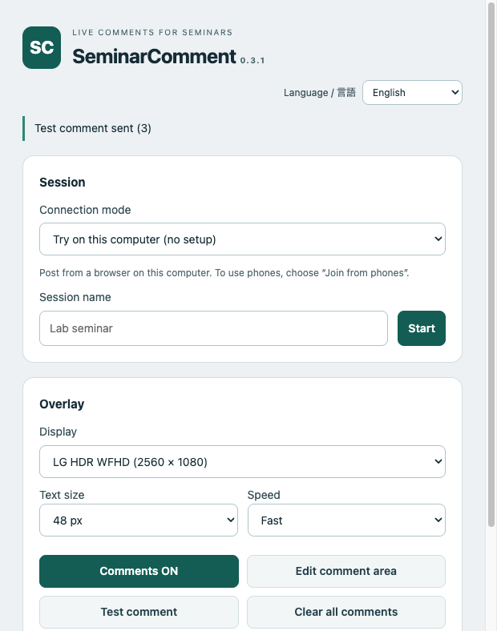
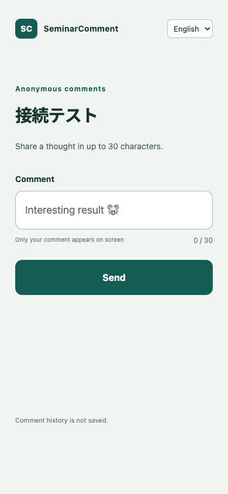

# SeminarComment 0.3.1

[日本語](README.md) | English

Anonymous live comments over PowerPoint slides, for macOS and Windows.
Participants scan a QR code and post from their phone browser, without names or accounts.
Comments move across the presenter's screen. No PowerPoint add-in is required.

## Download

You do not need Node.js or development tools to use the app.

| Presenter computer | Download |
| --- | --- |
| Mac with Apple Silicon (M1 or later) | [Mac Apple Silicon ZIP](https://github.com/haseren48-hue/SeminarComment/releases/download/v0.3.1/SeminarComment-0.3.1-mac-arm64.zip) |
| Intel Mac | [Mac Intel ZIP](https://github.com/haseren48-hue/SeminarComment/releases/download/v0.3.1/SeminarComment-0.3.1-mac-x64.zip) |
| Windows x64 | [Windows ZIP](https://github.com/haseren48-hue/SeminarComment/releases/download/v0.3.1/SeminarComment-0.3.1-win-x64.zip) |

[All releases](https://github.com/haseren48-hue/SeminarComment/releases)

The app is unsigned. OS security controls or your organization's policies may prevent it from opening.
Apple Silicon macOS has been tested. Intel Mac, Windows and multiple displays still need physical-device testing.

## Start a session

1. Extract the ZIP. Open `SeminarComment.app` on Mac or `SeminarComment.exe` on Windows. On Windows, keep the entire extracted folder together.
2. Choose **Join from phones**, enter a session name, and click **Start**. Both the presenter computer and phones need internet access.
3. Click **Show QR**. Participants scan it and send comments from their browsers.
4. Select the display used for your slideshow. In PowerPoint fullscreen, use Command + Shift + T (Mac) or Ctrl + Shift + T (Windows) to send a test comment.

No shared comment server is operated by this repository. Each presenter runs the app and creates their own session.
The phone connection uses Cloudflare Quick Tunnel, an experimental connection with no uptime guarantee. URLs change when the tunnel is recreated. Ended sessions and old QR codes cannot be reused.
For an existing HTTPS server, choose **Use an existing server** and enter its URL and presenter key. See the [deployment guide (Japanese)](docs/deployment.md).

## Languages

The presenter UI, QR card, and participant page support Japanese and English.
The initial language follows the device language: Japanese for Japanese devices, English otherwise.
Use **Language / 言語** to change it. The presenter preference is saved on the computer; each participant's preference is saved in their browser when storage is available.
Changing language preserves the draft comment and does not translate session names or posted comments.

 

## QR card and comments

- Drag the QR header to move the card. Drag its edges, or use **+ / −**, to resize it.
- Click **▁** to collapse it into a small tab. Click **Show QR** to restore it. Drag the tab's **⋮⋮** handle to move it.
- Position, size and collapsed state are saved. Use **Reset QR position and size** if needed.
- Closing or collapsing the QR does not stop comments or end the session. Comments pause while turned off or while editing the comment area.
- Participants can post up to 30 characters, including emoji. The queue retains up to 50 pending comments.

| Action | macOS | Windows |
| --- | --- | --- |
| Test comment | Command + Shift + T | Ctrl + Shift + T |
| Toggle comments | Command + Shift + C | Ctrl + Shift + C |
| Toggle QR | Command + Shift + Q | Ctrl + Shift + Q |
| Edit comment area | Command + Shift + R | Ctrl + Shift + R |
| Cancel editing | Esc | Esc |

Close the settings window to keep the app in the menu bar / system tray. Use **Quit app** to stop it.

## Privacy and limitations

Comment text is held in memory while displayed or queued; the app does not save comment history or its own IP access logs.
The experimental connection routes traffic through Cloudflare. Anyone with a session URL can access the participant page.
Sessions expire after 12 hours. Closing the app ends sessions using its embedded server. Comments missed during a connection outage are not replayed.

Automated tests cover 50 participant connections and ordered delivery of 50 posts. Two physical phones and posting after unlocking have been checked.
Continuous use by 40 phones for three hours, venue networks, external projection, and Windows/Intel Mac physical-device behavior remain unverified.
Test your actual presentation setup before relying on it. See [verification notes (Japanese)](docs/verification-public.md).

## Development

Requires Node.js 24+ and pnpm 11.25.0.

```sh
pnpm install --frozen-lockfile
pnpm prepare:tunnel
pnpm prepare:licenses
pnpm start
pnpm test
pnpm test:desktop
```

```sh
pnpm build:mac        # Apple Silicon and Intel ZIPs
pnpm build:win:zip    # Windows x64 ZIP
pnpm build:win        # Portable EXE; build on Windows
```

The tunnel preparation script downloads pinned cloudflared binaries from its official release and verifies SHA-256 hashes.
Build scripts include runtime and dependency license notices in the packaged app. Source archives do not include dependency or tunnel binaries.

## License and support

Original code: [MIT License](LICENSE). Third-party components retain their own licenses; see [third-party notices](THIRD_PARTY_NOTICES.md).

Report bugs in [Issues](https://github.com/haseren48-hue/SeminarComment/issues) with your OS, app version, and reproduction steps. Do not include presenter keys or personal information.
